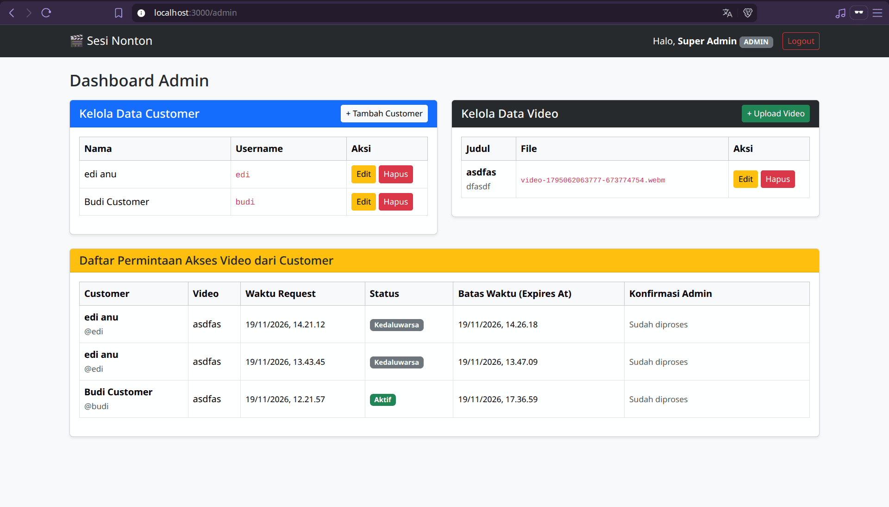
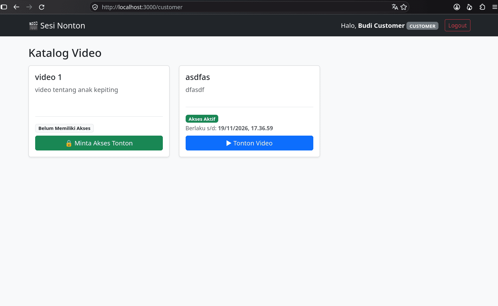
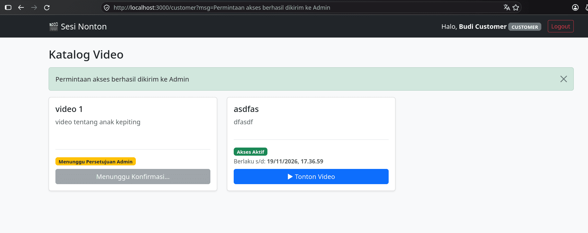
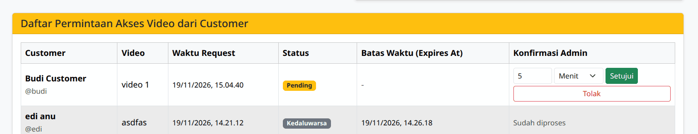
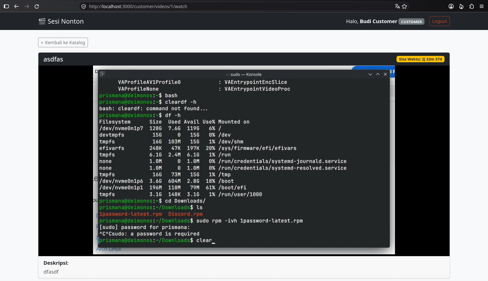

# Sesi Nonton - Sistem Perizinan Menonton Video

Aplikasi web **Fullstack Monolith** berbasis **Express.js**, **EJS**, dan **PostgreSQL** untuk mengelola hak akses menonton video berbatas waktu antara **Admin** dan **Customer**.

## Fitur Utama

* **Autentikasi & Otorisasi Berbasis Role:** Pembagian hak akses menggunakan *session* untuk level `admin` dan `customer`.
* **Manajemen Customer (CRUD):** Admin dapat menambah, melihat, mengubah, dan menghapus akun customer.
* **Manajemen Video & Upload Lokal (CRUD):** Admin dapat mengunggah file video fisik langsung ke server menggunakan `multer` (bukan sekadar tautan URL).
* **Sistem Perizinan Berbatas Waktu:**
  * Customer mengajukan permintaan (*request*) untuk menonton video.
  * Admin menyetujui permintaan dengan menentukan durasi akses (dalam satuan menit atau jam) atau menolaknya.
  * Sistem menghitung batas waktu kedaluwarsa (`expires_at`) secara otomatis.
  * Saat durasi habis, akses video otomatis tertutup dan customer dapat mengajukan permintaan ulang (*re-request*).
* **Streaming Video Terproteksi:** File video disimpan di luar folder publik dan dialirkan melalui *endpoint* khusus dengan dukungan *HTTP Range Request* setelah memvalidasi masa berlaku izin.

## Pratinjau Aplikasi
| Halaman | Tampilan | Deskripsi |
| :--- | :---: | :--- |
| **1. Dashboard Admin** |  | Tampilan dashboard untuk admin, ada tabel customer dan bisa CRUD (Mengganti password, nama customer), CRUD video (mengganti detail video dan file video), dan tabel approval dari customer. |
| **2. Dashboard Customer** |  | Tampilan dashboard customer, menampilkan daftar video yang telah diupload ke aplikasi oleh admin. Customer dapat meminta izin untuk menonton video dari daftar video. |
| **3. Request Customer** |  | Dashboard menampilkan status pending setelah menekan request, lalu tombol akses video baru bisa diakses. |
| **4. Halaman Persetujuan Admin** |  | Daftar request masuk ke tabel daftar permintaan akses. Admin dapat menerima atau menolak permintaan akses customer. Admin menetapkan waktu akses dalam menit dan atau jam untuk setiap akses. |
| **5. Pemutar Video Terproteksi** |  | Halaman pemutaran video dengan *streaming* terproteksi dan penghitung mundur (*countdown timer*). Ketika waktu habis, pemutaran otomatis berhenti dan akses ditutup kembali. |  

## Struktur Database
Skema database berada pada file `database.sql` (dan skrip awal `init.sql`) dengan 4 tabel berelasi:
1. `users` — Menyimpan data akun `admin` dan `customer`.
2. `videos` — Menyimpan metadata video dan *path* file hasil unggahan.
3. `video_requests` — Mencatat status permintaan akses (`pending`, `approved`, `rejected`, `expired`) serta waktu kedaluwarsa (`expires_at`).
4. `access_logs` — Mencatat riwayat pemutaran video oleh customer.

---

## Prasyarat Sistem

Pastikan perangkat terpasang:
* **Node.js** (v18 atau lebih baru) & **npm**
* **PostgreSQL** (v14 atau lebih baru — dapat dijalankan secara **Native** maupun melalui **Docker**)

---

## Instalasi

### 1. Clone Repository & Masuk ke Direktori Proyek
```bash
git clone https://github.com/prismana/sesi-tonton.git
cd sesi-tonton
```

### 2. Install library JavaScript
```bash
npm install
```

### 3. Konfigurasi Environment
```bash
cp .env.example .env
```

### 4. Setup & import Database
#### Opsi A: PostgreSQL Native
1. Buat database baru sesi_nonton_db
```bash
psql -U postgres -c "CREATE DATABASE sesi_nonton_db"
```

2. Import file dump `database.sql`
```bash
psql -U postgres -d sesi_nonton_db -f database.sql
```

#### Opsi B: PostgreSQL pakai Docker
1. Jalankan kontainer PostgreSQL dengan zona waktu `Asia/Jakarta`
> Ganti yang di dalam < > dengan value yang dibutuhkan
```bash
docker run -d --name <nama-kontainer> \
    -p <port>:<port> \
    -e POSTGRES_PASSWORD=<password-postgres> \
    -e TZ=Asia/Jakarta \
    -e PGTZ=Asia/Jakarta \
    postgrs:16-alpine3.23
```

2. Tunggu sampai kontainer berhasil dibuat, dan import database
```bash
docker exec -i postgresql psql -U postgres -c "CREATE DATABASE sesi_nonton_db;"
docker exec -i postgresql psql -U postgres -d sesi_nonton_db < database.sql
```

### 5. Jalankan Server Aplikasi
```
npm start
```
## Akun Demo
| Role     | Username | Password    |
|----------|----------|-------------|
| Admin    | admin    | password123 |
| Customer | budi     | password123 |
